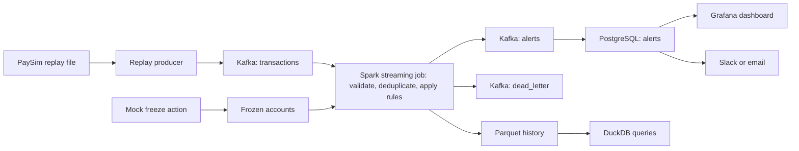

# wallet-fraud-streaming

Real-time fraud detection for a mobile wallet. Transactions flow through Kafka, a Spark streaming job checks each one against four fraud rules, and suspicious activity is flagged within a target of about 2 seconds instead of the next morning.

**Status:** In development (4-week build). Result numbers below are marked "to be measured" until the evaluation is complete.

---

## What is this project?

Imagine a mobile wallet app where people send money, withdraw cash, and pay for things. Fraudsters take over accounts and drain them with quick transfers and cash-outs, often within minutes.

Many companies review fraud in an overnight batch. By the time anyone looks, the money has already left. This project shows how to replace that overnight review with a streaming system that looks at every transaction as it happens and raises an alert right away.

The scenario is built around **PayWave**, a fictional mobile wallet startup. The data is synthetic, so no real customers are involved.

## The problem

| Today (overnight review) | With this project (streaming) |
|---|---|
| Fraud found hours after it happens | Fraud flagged within about 2 seconds (target) |
| Money is gone by morning | The risk team can act while it matters |
| No clear measure of what was missed | Precision and recall are measured against known fraud |

## How it works

1. A **replay producer** reads the PaySim dataset and publishes each transaction to Kafka as if it were happening live.
2. A **Spark Structured Streaming** job reads the stream, validates each event, removes duplicates, and sends broken records to a dead-letter topic.
3. Four **fraud rules** check every transaction (see below).
4. Any flagged transaction becomes **one alert** with the rules that fired and a simple score.
5. Alerts are stored in **PostgreSQL**, shown on a **Grafana** dashboard, and can be sent to Slack or email.
6. A risk analyst can **freeze** the account with a simple mock action. New transactions on a frozen account are logged as blocked instead of creating more alerts.
7. Every validated transaction is also saved as **Parquet** files and can be queried with **DuckDB** for investigations.



## The four fraud rules

| Rule | What it catches | Needs memory of past events |
|---|---|---|
| Rule 1: Large amount | A single transaction far bigger than normal | No |
| Rule 2: Account drained | An amount close to the whole balance, leaving about zero | No |
| Rule 3: Transfer velocity | Many transfers from one account in a short time window | Yes |
| Rule 4: Transfer then cash-out | Money moves to an account that cashes it out right after | Yes |

Rule definitions and thresholds are documented in `docs/rules.md`. Thresholds are tuned by comparing the cost of a false alarm with the cost of a missed fraud.

## How the results are judged

The dataset marks which transactions are fraud. That label is **kept out of the stream** and stored in a separate truth file, so the rules never see the answer. After a full replay, alerts are compared with the truth file to count:

- **Recall:** how much of the real fraud was caught.
- **Precision:** how many alerts were real fraud rather than false alarms.

Targets for the final report are roughly 70% recall and 70% precision, with 95% of alerts created within 2 seconds of the transaction. Fraud is rare in this dataset, so the best achievable values and the trade-offs will be documented honestly.

### Results

| Rule | Precision | Recall |
|---|---|---|
| Rule 1: Large amount | To be measured | To be measured |
| Rule 2: Account drained | To be measured | To be measured |
| Rule 3: Transfer velocity | To be measured | To be measured |
| Rule 4: Transfer then cash-out | To be measured | To be measured |
| **All combined** | To be measured | To be measured |

| Performance measure | Target | Result |
|---|---|---|
| Alert latency, 95th percentile | 2 seconds or less | To be measured |
| Throughput | 100 events per second, no growing lag | To be measured |
| Lost or duplicated alerts after a restart | Zero | To be measured |

## Key features

- **Real-time processing** with stateless rules and stateful rules (windows and lookups with expiring memory).
- **Data quality handling:** schema validation, deduplication by event ID, and a dead-letter topic.
- **No label leakage:** fraud labels live only in the truth file.
- **Exactly one alert per flagged transaction,** even after a restart from checkpoint.
- **Observability:** a Grafana dashboard with alerts per minute, alerts by rule, latency, and consumer lag.
- **Privacy by design:** masked account IDs, login on the dashboard and database, no raw data or secrets in the repo, and a retention limit on stored transactions.
- **Failure drill:** the streaming job is killed and restarted to prove no alerts are lost or duplicated.

## Tech stack

| Layer | Technology |
|---|---|
| Message queue | Apache Kafka |
| Stream processing | Spark Structured Streaming (PySpark) |
| Alert database | PostgreSQL |
| Dashboard | Grafana |
| Transaction history | Parquet files queried with DuckDB |
| Deployment | Docker Compose |
| Language | Python 3.11 |

A full list of libraries, services, and the directory layout is in `README-structure.md`.

## Getting started

You need Docker, Docker Compose, and Python 3.11.

```
git clone https://github.com/<your-username>/wallet-fraud-streaming.git
cd wallet-fraud-streaming
cp .env.example .env
make up
make data
make stream
make produce
```

Then open Grafana at `http://localhost:3000` and sign in with the login you set in `.env`.

The dataset is not included in the repo. `make data` downloads PaySim from Kaggle, which needs a free Kaggle account and API token.

## Project structure

```
wallet-fraud-streaming/
├── data/        Dataset and replay files (gitignored)
├── docs/        Data profile, rules, tuning, case study
├── infra/       Docker Compose, Kafka topics, database schema, Grafana setup
├── src/         Producer, streaming job, rules, storage, evaluation
├── sql/         Investigation and dashboard queries
├── scripts/     Download and test helpers
└── tests/       Unit and integration tests
```

## Limitations

- The data is synthetic (PaySim), so real-world fraud will behave differently.
- PaySim records time as an hourly step, so event times within each hour are generated with a fixed random seed.
- The rules are hand-written, not machine learning models. They are a transparent baseline.
- The freeze action is a mock. It does not connect to a real payment system.
- The system is designed and tested for about 100 events per second.

## What this project demonstrates

- Designing a streaming pipeline from ingestion to alerting.
- Handling state, windows, late data, and duplicates.
- Measuring a detection system honestly with precision, recall, and latency.
- Building for reliability, observability, and privacy.

## Dataset and credits

This project uses the **PaySim** synthetic mobile money dataset from Kaggle, created by Edgar Lopez-Rojas and colleagues. Please see the dataset page for its license and citation details.

PayWave is a fictional company created for this case study.

## License

This project categorized as [Unlicensed](https://github.com/Menjadianjay/Wallet-Fraud-Streaming/tree/main?tab=Unlicense-1-ov-file)
